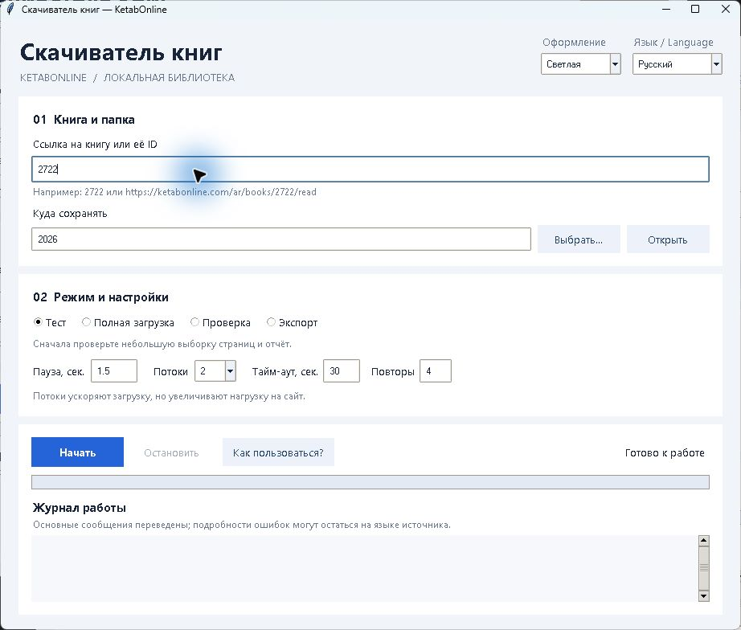

# KetabOnline Book Downloader — скачать книги с KetabOnline

**Русский** · [English](docs/README.en.md) · [العربية](docs/README.ar.md) · [Türkçe](docs/README.tr.md)

Локальная программа для скачивания доступного текста книг с KetabOnline:
графический интерфейс, продолжение после остановки и экспорт в TXT, Markdown
и JSONL. Интерфейс поддерживает русский, английский, арабский и турецкий языки.



Инструмент последовательно сохраняет публично доступный текст из встроенного серверного состояния Nuxt страниц чтения KetabOnline. Он не исполняет JavaScript страницы, не обходит авторизацию, CAPTCHA, Cloudflare или ограничения доступа, не использует массовый параллелизм и не исправляет предполагаемые OCR-ошибки.

Основная единица хранения — физическая страница книги. В каждой записи отдельно сохраняются исходный текст, очищенный только от краевых интерфейсных пробелов текст, заголовки, том, глобальный индекс, видимый номер страницы, источник, соседние идентификаторы, контрольная сумма и метаданные всех абзацев.

## Как скачать книгу с KetabOnline?

Откройте приложение, вставьте ссылку на чтение книги либо её ID, выполните
контрольный тест и выберите полную загрузку. При повторном запуске в ту же папку
программа продолжит сохранение. Скачивается доступный текст книги с метаданными,
а не оригинальный PDF издательства. Это независимый проект, не связанный с
администрацией KetabOnline; другие книжные магазины загрузчик не поддерживает.

## Требования

- Python 3.12 или новее, с Tkinter для графического интерфейса;
- внешние Python-пакеты для загрузчика не требуются;
- OCR PDF — отдельная функция, для которой нужны Poppler, Tesseract и языковые данные (см. ниже).

## Установка и запуск в Windows

1. Установите [Python](https://www.python.org/downloads/) версии 3.12 или новее; при установке включите Tkinter и добавление Python в PATH.
2. Скачайте и распакуйте исходники проекта. Откройте PowerShell в папке проекта.
3. Выполните `python --version`, затем `python gui.py`. Либо дважды нажмите `start-gui.cmd`.

Если команда `python` не найдена, используйте `py -3 gui.py` и убедитесь,
что выбранная версия Python не ниже 3.12. Графический интерфейс запускается
из папки исходников; команда `ketab-download` из устанавливаемого Python-пакета
предназначена для консольной работы.

Тесты запускаются командой `python -m unittest discover -s tests -v`.

## Условия использования

Применяйте программу с соблюдением правил источника, авторских прав и других
применимых ограничений. Публичный доступ к странице не означает разрешения на
массовое скачивание или дальнейшее распространение её содержимого. Загруженные
книги и результаты работы не входят в исходники и исключены из Git.

Код распространяется по [PolyForm Strict License 1.0.0](LICENSE). Это лицензия
с ограничениями: она разрешает определённое некоммерческое использование, но
не предоставляет разрешение на распространение программы или создание её
изменённых версий. Полные условия приведены в файле лицензии; сторонние
компоненты и содержимое книг могут иметь собственные условия.

## Графический интерфейс

В Windows запустите `start-gui.cmd` двойным нажатием. Также окно можно открыть
командой `python gui.py` из папки проекта; для этого нужен Python с Tkinter.
Введите ссылку KetabOnline или ID книги, выберите папку результатов и режим.
По умолчанию запускается контрольная выборка; для скачивания книги выберите
«Полная загрузка / продолжить». Повторный запуск продолжает сохранённые страницы.
Кнопка остановки завершает процесс; уже записанные страницы сохраняются.
Режим экспорта проверяет и экспортирует ранее загруженную полную книгу.
Язык интерфейса выбирается в правом верхнем углу: русский, английский,
арабский или турецкий. Кнопка «Как пользоваться?» открывает краткую инструкцию.
В настройках также доступны тайм-аут и число повторов временных ошибок.
Выбранный язык запоминается в `.gui-preferences.json`, который исключён из Git.
Рядом с выбором языка находится переключатель оформления: светлая, тёмная
и сепия. Тема также сохраняется между запусками.
В арабском режиме расположение основных элементов отражается справа налево.
Основные сообщения журнала переводятся; прочие технические сообщения и ошибки
сохраняются на исходном языке, чтобы не терять подробности диагностики.

## Быстрый контрольный запуск

```powershell
python download.py --url "https://ketabonline.com/ar/books/2722/read?part=1&index=2049845" --test
```

Результаты контрольной выборки появятся в `output/2722/test/`:

- `fragments.jsonl`;
- `preview.md`;
- `validation_report.md`.

Этот режим исследует тома и скачивает распределённую выборку: начало, середину, конец и обе стороны границ томов. Полную книгу он не загружает.

## Полная загрузка

Запускайте только после просмотра контрольного отчёта:

```powershell
python download.py --book-id 2722 --delay 2 --workers 2
```

`--workers 2` держит до двух одновременных запросов в полной загрузке. Для более осторожного режима используйте `--workers 1`; для ускорения с повышенной нагрузкой можно пробовать `--workers 3` или `--workers 4`.

Прогресс сохраняется в `output/2722/fragments.sqlite3` после каждой успешно разобранной физической страницы. Повторный запуск автоматически продолжает работу и не запрашивает уже сохранённые страницы.

```powershell
python download.py --book-id 2722 --restart
python download.py --book-id 2722 --validate-only
python download.py --book-id 2722 --export
```

`--restart` очищает только основную SQLite-базу и журнал ошибок внутри неё. Контрольные файлы и проблемные HTML-ответы остаются на диске.

## Итоговые файлы

После полной успешной проверки создаются:

- `complete.txt`;
- `complete.md`;
- `complete.jsonl`;
- `manifest.json`;
- `download_report.md`;
- отдельные Markdown- и JSONL-файлы для каждого реально обнаруженного тома (`part-01.md`, `part-01.jsonl` и т. д.).

## Надёжность

- полная загрузка выполняет ограниченное число одновременных запросов (`--workers`, по умолчанию 2);
- между запросами действует настраиваемая пауза;
- временные сетевые ошибки повторяются с экспоненциальной задержкой;
- постоянные HTTP-ошибки не повторяются;
- `Ctrl+C` завершает текущий ответ и безопасно останавливает цикл;
- неожиданные или пустые ответы сохраняются в `problem_pages/`;
- одинаковое содержимое разных страниц отмечается предупреждением, но не удаляется;
- экспорт полной книги выполняется только после проверки непрерывности и контрольных сумм.

Настройки можно скопировать из `config.example.toml` в `config.toml`.

Подробная схема сайта и известные ограничения описаны в `discovery_report.md`.

## Локальный тест OCR арабского PDF

`tools/ocr_arabic_pdf.py` использует локальные Poppler и Tesseract с арабской
моделью `ara`. Установите [Tesseract](https://tesseract-ocr.github.io/tessdoc/Installation.html)
и [Poppler для Windows](https://github.com/oschwartz10612/poppler-windows/releases),
сделайте `tesseract` и `pdftoppm` доступными через PATH или укажите их пути
параметрами `--tesseract` и `--pdftoppm`. Скачайте [арабские языковые данные](https://github.com/tesseract-ocr/tessdata_fast/blob/main/ara.traineddata)
и поместите `ara.traineddata` в каталог данных Tesseract либо укажите его каталог
через `--tessdata-dir`. Допускается также `runtime/ocr/tessdata/` в проекте.
Эти внешние компоненты не включены в репозиторий.

Список страниц обязателен: у скрипта нет неявного режима обработки
всего PDF, а выборка свыше 25 страниц требует дополнительного защитного флага.
Пример контрольной выборки из пяти страниц (путь к PDF замените на свой):

```powershell
python tools\ocr_arabic_pdf.py `
  --input "C:\Books\book.pdf" `
  --pages 10,94,188,281,373 `
  --output-dir "output\kitab-al-asl-ocr-test" `
  --lang ara --dpi 300 --workers 1
```

Повторный запуск с теми же параметрами проверяет контрольные суммы и использует
готовые страницы из кэша. Результаты сохраняются в UTF-8: исходный OCR — в
`raw/`, безопасно нормализованный текст — в `text/`, сводные записи — в
`ocr-results.jsonl`, настройки и контрольные суммы — в `manifest.json`, ошибки —
в `ocr-report.md`. Контрольная сумма языковой модели входит в кэш, поэтому её
замена автоматически запускает новое распознавание. Скрипт не выполняет
смысловое исправление арабского текста.
