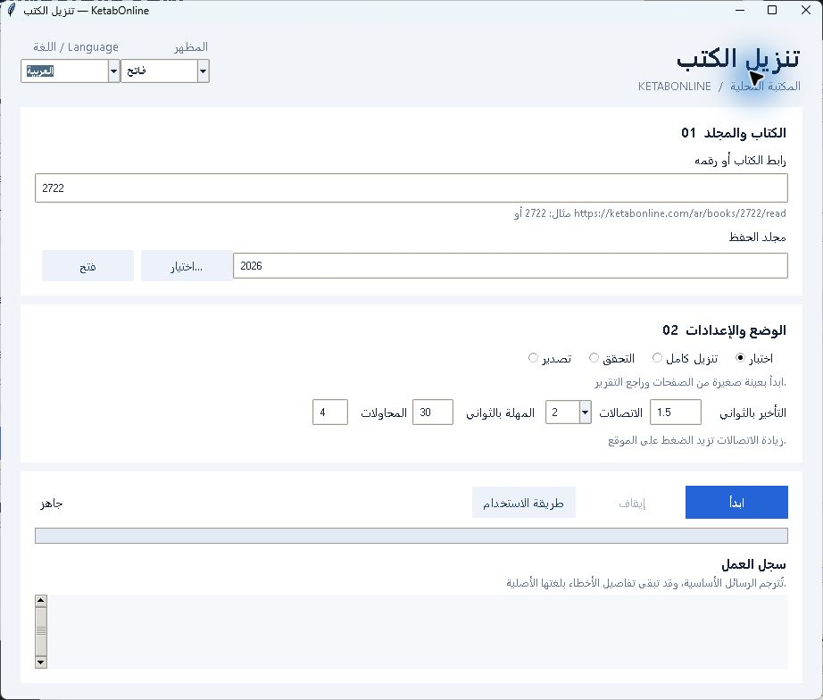

# تنزيل كتب KetabOnline — برنامج تحميل الكتب من جامع الكتب الإسلامية

[Русский](../README.md) · [English](README.en.md) · **العربية** · [Türkçe](README.tr.md)

برنامج محلي بلغة Python لتنزيل النصوص المتاحة للعامة من كتب KetabOnline،
واستكمال التنزيل بعد انقطاعه، وتصدير الكتب إلى TXT وMarkdown وJSONL.
يحافظ على النص العربي والتشكيل، ومعلومات الأجزاء وأرقام الصفحات وروابط المصادر.
لا يتطلب خدمة ذكاء اصطناعي مدفوعة.



## كيف أنزل كتاباً من KetabOnline؟

لمستخدمي Windows 10/11 x64 يتوفر الملف `KetabOnline-Setup-0.1.0-x64.exe`
في [الإصدارات](https://github.com/urusoff16/ketabonline-book-downloader/releases).
يتضمن Python ولا يحتاج إلى تثبيته منفصلاً. تُحفظ الإعدادات والكتب في
`%LOCALAPPDATA%\KetabOnlineDownloader\`. ملف التثبيت غير موقّع رقمياً، وتتوفر
بصمة SHA-256 للتحقق منه. أداة OCR لملفات PDF غير مضمّنة في التثبيت.

للتشغيل من المصدر:

1. ثبّت Python بالإصدار 3.12 أو أحدث مع Tkinter، ثم نزّل ملفات المشروع.
2. شغّل `python gui.py` من مجلد المشروع. في Windows يمكنك أيضاً فتح `start-gui.cmd`.
3. أدخل رابط قراءة الكتاب في KetabOnline أو رقمه، وحدد مجلد الحفظ.
4. ابدأ بوضع **اختبار**، ثم راجع التقرير في `output/<book-id>/test/`.
5. اختر **تنزيل كامل**. للاستكمال بعد الانقطاع استخدم رقم الكتاب ومجلد الحفظ نفسيهما.

يمكن اختيار العربية أو الروسية أو الإنجليزية أو التركية من قائمة اللغة أعلى
النافذة. ينعكس ترتيب العناصر الأساسية من اليمين إلى اليسار عند اختيار العربية.
تتوفر ثلاثة مظاهر: فاتح وداكن وبني دافئ، وتُحفظ تفضيلات اللغة والمظهر تلقائياً.
يمكن ضبط التأخير وعدد الاتصالات من 1 إلى 4 والمهلة وعدد المحاولات.
يفحص وضع **التحقق** الكتاب الكامل المحفوظ؛ ويُنشئ **تصدير** الملفات النهائية أيضاً.
تُترجم رسائل السجل الأساسية، وقد تبقى تفاصيل الأخطاء غير المعتادة بلغتها الأصلية.

مثال للاختبار من سطر الأوامر:

```powershell
python download.py --book-id 2722 --test
```

يُحفظ التقدم في SQLite. ينتج التنزيل الكامل ملفات `complete.txt` و`complete.md`
و`complete.jsonl` وملفات منفصلة لكل جزء. البرنامج لا ينزّل ملف PDF الأصلي للناشر.
تتطلب أداة التعرف الضوئي المحلية الاختيارية ملفات Poppler وTesseract وبيانات
اللغة؛ راجع [المرجع المفصل](../README.md).

## نطاق الاستخدام والترخيص

هذه أداة مستقلة لموقع KetabOnline وليست أداة عامة لمتاجر الكتب الأخرى.
لا تتجاوز تسجيل الدخول أو CAPTCHA أو قيود الوصول. التزم بشروط المصدر وحقوق
النشر؛ إتاحة النص للعامة لا تعني السماح بإعادة توزيعه. الكتب المنزلة ليست جزءاً من المستودع.

يخضع البرنامج لترخيص [PolyForm Strict License 1.0.0](../LICENSE).
يسمح الترخيص باستخدامات غير تجارية محددة، لكنه لا يمنح بحد ذاته إذناً بتعديل
البرنامج أو إعادة توزيعه. يرجى قراءة الشروط الكاملة.

تشغيل الاختبارات المحلية: `python -m unittest discover -s tests -v`.
