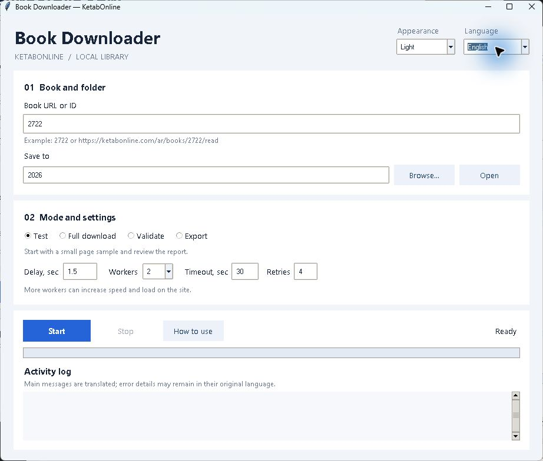

# KetabOnline Book Downloader — download books from KetabOnline

[Русский](../README.md) · **English** · [العربية](README.ar.md) · [Türkçe](README.tr.md)

Download publicly accessible book text from KetabOnline to your computer, resume
interrupted downloads and export a local library to TXT, Markdown and JSONL.
This Python desktop application preserves Arabic Unicode and diacritics, book
volumes, page numbers and source links. No paid AI service is required.



## How to download a book from KetabOnline

1. Install Python 3.12 or newer with Tkinter and download the project sources.
2. In the project folder, run `python gui.py`. On Windows you can also open `start-gui.cmd`.
3. Paste a KetabOnline reader URL or enter the numeric book ID. Choose an output folder.
4. Run **Test**, then inspect the report in `output/<book-id>/test/`.
5. Select **Full download**. To resume later, use the same ID and output folder.

Language and appearance controls are at the top of the window. Choose English,
Russian, Arabic or Turkish, and a light, dark or sepia theme. Preferences are saved.
Delay, workers (1–4), timeout and retries control network requests. **Validate**
checks an already saved complete book; **Export** also writes output files.
Main log messages are translated; unusual error details retain their original text.

For a console test:

```powershell
python download.py --book-id 2722 --test
```

Saved full downloads use SQLite for progress and export `complete.txt`,
`complete.md`, `complete.jsonl` and separate files for each volume. The program
does not download an original publisher PDF. The optional local PDF OCR tool
requires Poppler, Tesseract and language data; see the [full reference](../README.md).

## Scope and license

This is an independent tool for KetabOnline, not a general downloader for other
bookstores. It does not bypass login, CAPTCHA or access restrictions. Respect the
source's terms and copyright; public availability does not grant redistribution rights.
Downloaded books are not included in this repository.

The software is licensed under [PolyForm Strict License 1.0.0](../LICENSE),
which permits specified noncommercial uses but does not itself grant permission
to redistribute or modify the software. Read the full terms before use.

Run the offline unit tests with `python -m unittest discover -s tests -v`.
