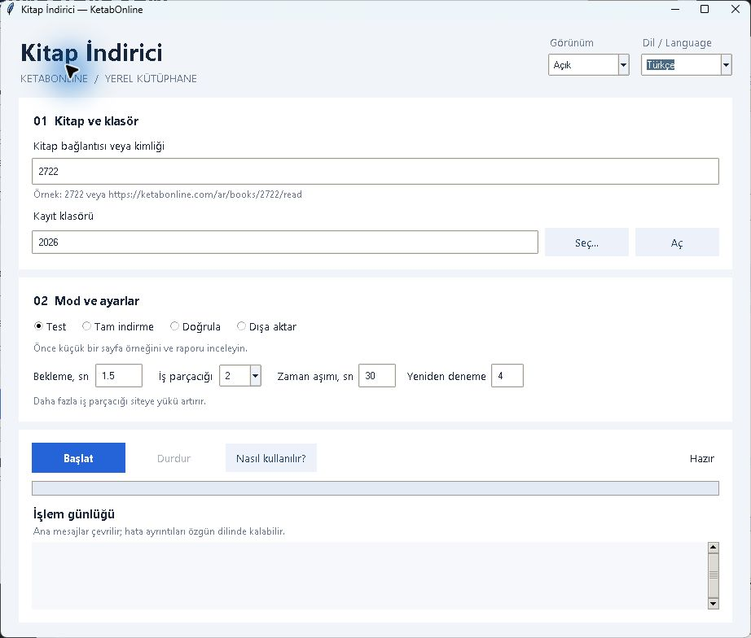

# KetabOnline Kitap İndirici — KetabOnline'dan kitap indirme

[Русский](../README.md) · [English](README.en.md) · [العربية](README.ar.md) · **Türkçe**

KetabOnline'da herkese açık kitap metinlerini bilgisayarınıza indirmek, kesilen
indirmelere devam etmek ve TXT, Markdown ya da JSONL dosyaları oluşturmak için
yerel bir Python uygulaması. Arapça Unicode metni, harekeler, cilt bilgileri,
sayfa numaraları ve kaynak bağlantıları korunur. Ücretli yapay zekâ hizmeti gerekmez.



## KetabOnline'dan nasıl kitap indirilir?

Windows 10/11 x64 için [Releases](https://github.com/urusoff16/ketabonline-book-downloader/releases)
sayfasından `KetabOnline-Setup-0.1.0-x64.exe` dosyasını indirin. Python dahildir.
Ayarlar ve kitaplar `%LOCALAPPDATA%\KetabOnlineDownloader\` altında saklanır.
Kurulum dosyası dijital olarak imzalanmamıştır; SHA-256 özeti yayımlanır.
PDF OCR aracı kurulum dosyasına dahil değildir.

Kaynak koddan çalıştırmak için:

1. Tkinter içeren Python 3.12 veya daha yeni bir sürüm kurun ve proje kaynaklarını indirin.
2. Proje klasöründe `python gui.py` komutunu çalıştırın. Windows'ta `start-gui.cmd` dosyasını da açabilirsiniz.
3. Kitabın KetabOnline okuma bağlantısını veya sayısal kimliğini girin ve kayıt klasörünü seçin.
4. Önce **Test** çalıştırın; `output/<kitap-kimliği>/test/` klasöründeki raporu inceleyin.
5. **Tam indirme** seçeneğini kullanın. Kesintiden sonra aynı kimlik ve klasörle devam edin.

Üstteki dil ve görünüm menülerinden Türkçe, Rusça, İngilizce veya Arapça ile
açık, koyu ya da sepya temasını seçebilirsiniz. Tercihler kaydedilir. Bekleme,
iş parçacığı sayısı (1–4), zaman aşımı ve yeniden deneme sayısı ayarlanabilir.
**Doğrula** kaydedilmiş tam kitabı kontrol eder; **Dışa aktar** ayrıca çıktı
dosyalarını oluşturur. Ana günlük mesajları çevrilir; olağan dışı hata ayrıntıları
özgün dilinde kalabilir.

Konsoldan test:

```powershell
python download.py --book-id 2722 --test
```

İlerleme SQLite ile saklanır. Tam indirme `complete.txt`, `complete.md`,
`complete.jsonl` ve her cilt için ayrı dosyalar üretir. Uygulama yayınevinin
özgün PDF dosyasını indirmez. İsteğe bağlı yerel PDF OCR aracı Poppler, Tesseract
ve dil verileri gerektirir; [ayrıntılı başvuruya](../README.md) bakın.

## Kapsam ve lisans

Bu bağımsız araç KetabOnline içindir; diğer kitap mağazalarını desteklemez.
Oturum açma, CAPTCHA veya erişim kısıtlamalarını aşmaz. Kaynağın koşullarına
ve telif haklarına uyun; herkese açık erişim yeniden dağıtım izni anlamına gelmez.
İndirilen kitaplar bu depoya dahil değildir.

Yazılım [PolyForm Strict License 1.0.0](../LICENSE) ile lisanslanmıştır.
Lisans belirli ticari olmayan kullanımlara izin verir; kendisi yazılımı değiştirme
veya yeniden dağıtma izni sağlamaz. Tam koşulları okuyun.

Yerel testler: `python -m unittest discover -s tests -v`.
